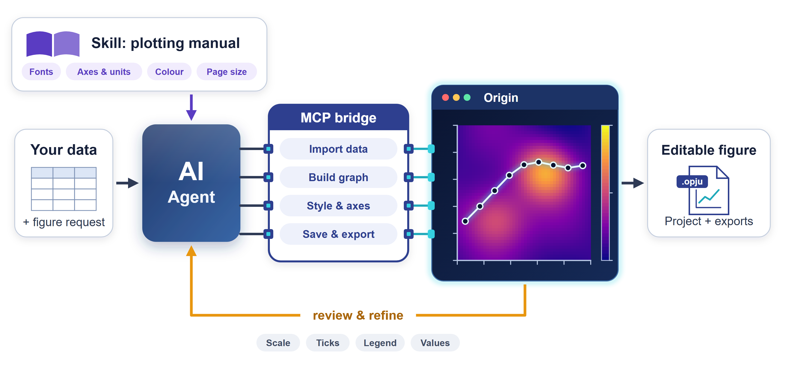

# Origin MCP + Skill for Scientific Plots

**English** | [简体中文](README.zh-CN.md)

Origin MCP + Skill lets an AI agent make clear, editable, journal-style figures in Origin from your data and a plain description of the figure you want. Origin is built for people working through menus and dialogs; the MCP bridge lets the agent operate it directly, and the Skill gives the agent a plotting manual.

- **An agent that can drive Origin.** Through the MCP bridge, the agent imports data, builds and styles graphs, saves projects, and exports figures, with no manual clicking.
- **Journal conventions built in.** The Skill applies figure guidance from Nature and NIST: font sizes, page dimensions, axes, units, colours, and legends, with italic variables and upright units.
- **Checked, editable results.** The agent reviews the rendered figure and refines it, checks values and data bindings, and delivers an Origin project you can keep editing.

## Working with it

Give it your data and the figure you want. If the graph type is missing or clearly does not fit the data, the agent suggests one before drawing. Existing figures can be refreshed by updating their bound data. Each delivery includes an Origin project (`.opju`) and figure exports such as PNG and PDF.

The repository contains the [Skill](skills/origin-figures/SKILL.md), the bundled [MCP source](mcp/README.md) with this project's [adaptations](UPSTREAM_CHANGES.md), execution helpers, and the examples below. The [workflow guide](skills/origin-figures/references/common-workflow.md) describes the full process.

## Examples

The following examples use synthetic data.

<table>
  <tr>
    <td align="center"></td>
    <td align="center"></td>
  </tr>
  <tr>
    <td align="center"></td>
    <td align="center"></td>
  </tr>
</table>

## Getting started

You need Windows, a licensed Origin or OriginPro, Python for the bundled MCP, and an agent that can use MCP and load a Skill. Follow the [installation guide](INSTALLATION.md), then start from the [Skill entry point](skills/origin-figures/SKILL.md). Use the bundled MCP source rather than the upstream package so this project's adaptations are included.

Checked on Windows with OriginPro 2026; see [validation details](VALIDATION.md). Built and tested with Codex; other MCP-compatible agents may also work but have not been tested.

## Acknowledgements and license

The Origin MCP component builds on [Ge-Shun/origin-mcp](https://github.com/Ge-Shun/origin-mcp). Its [license](mcp/LICENSE) and [notices](mcp/NOTICE) are retained; adaptations are documented in [UPSTREAM_CHANGES.md](UPSTREAM_CHANGES.md).

Scientific visualization and graph-selection methods are informed by [K-Dense-AI/scientific-agent-skills](https://github.com/K-Dense-AI/scientific-agent-skills) and [Karthik's data visualization skill](https://github.com/skthewimp/karthik-data-visualization-skill), adapted here for the Origin workflow.

Figure formatting draws on the [Nature figure guide](https://research-figure-guide.nature.com/figures/building-and-exporting-figure-panels/) and [NIST guidance on symbols and units](https://physics.nist.gov/cuu/Units/checklist.html).

New project code and Skill content use the [MIT License](LICENSE). Original licenses and attribution are retained in [third-party notices](THIRD_PARTY_NOTICES.md) and the bundled source.
