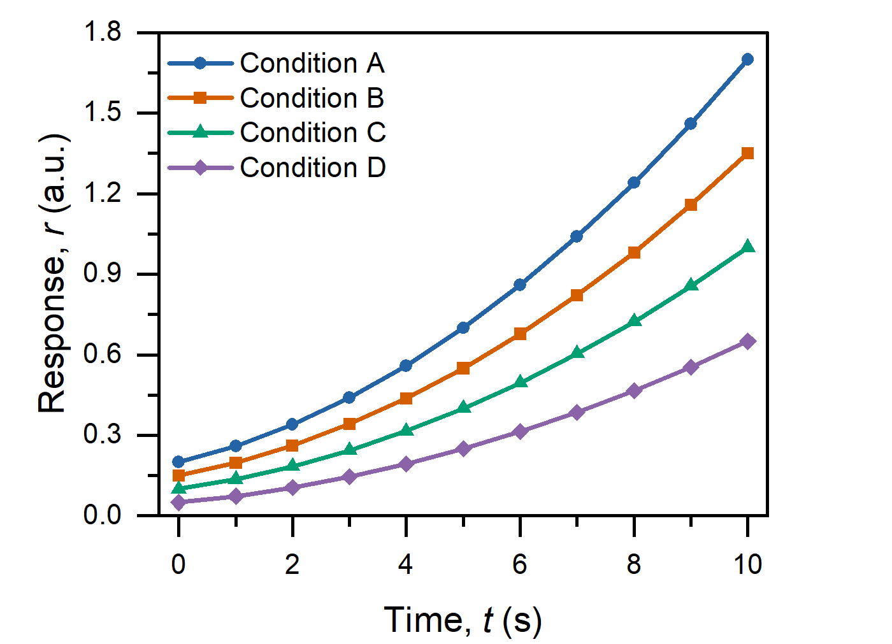
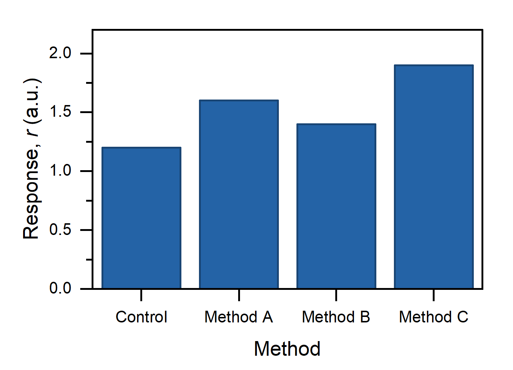
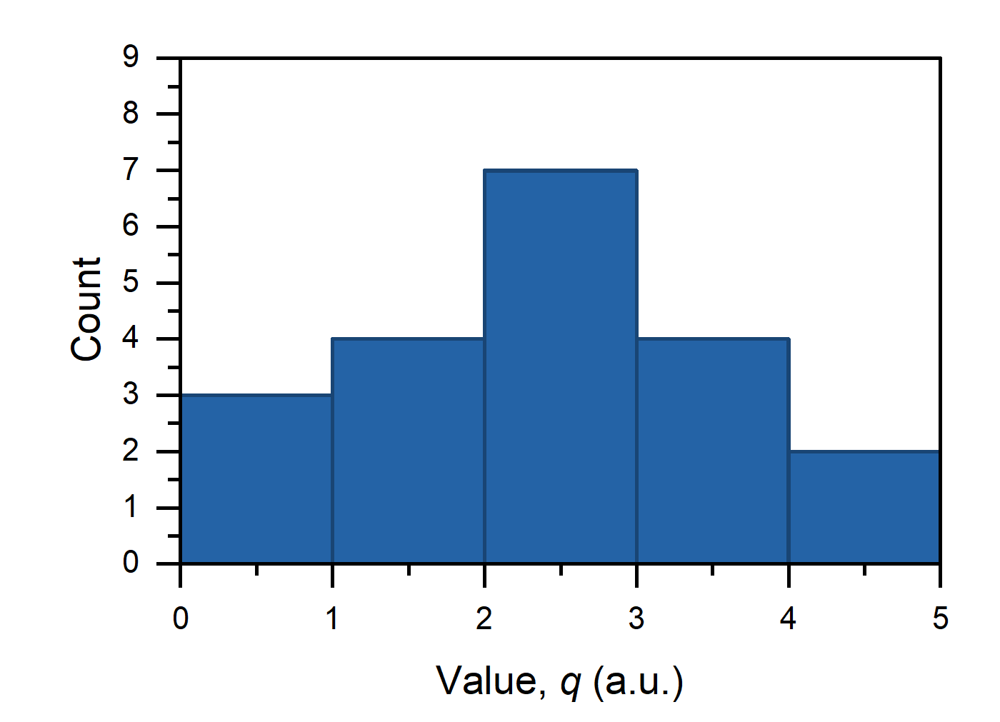
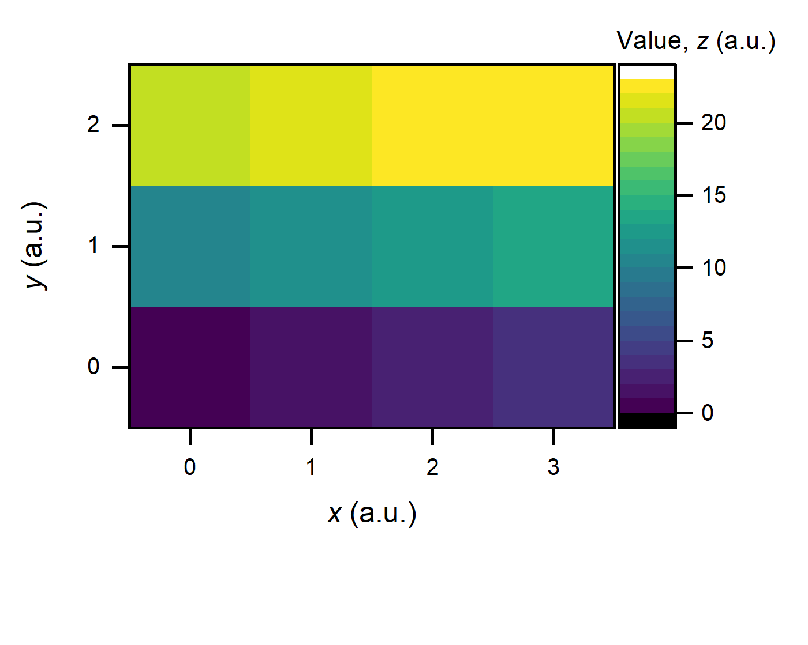

# Origin MCP + Skill for Scientific Plots

[English](README.md)

**Origin_MCP-Skill_for_Scientific-Plots** 让 AI Agent 根据你的数据和绘图要求，在 Origin 中创建、调整并交付清晰、可编辑的科研图表。

## 项目能做什么

提供数据并说明想画什么图，Agent 就能在 Origin 中完成绘图。没有指定图型，或要求与数据明显不匹配时，Agent 可以提出建议，帮助你确定合适的画法。

坐标轴、单位、标签、符号、配色、图例和页面布局也纳入同一流程。Agent 可以检查实际画面，逐步调整图表；对于已有图表，也可以通过更新绑定的数据来刷新结果。交付包括可继续编辑的 Origin 工程与图形导出，并检查数值、图形绑定以及保存后的结果。

## MCP 与 Skill 如何配合

**MCP 让 Agent 操作 Origin：**导入数据、创建和调整图表、保存工程、导出图形。

**Skill 用科研绘图经验指导操作：**设置字体字号、页面尺寸、坐标轴、配色和图例，并遵循变量斜体、单位正体等排版规则。

本项目包含 Agent Skill、适用于该工作流的 MCP 调整、执行辅助工具和绘图示例。具体方法见 [Skill](skills/origin-figures/SKILL.md)、[工作流说明](skills/origin-figures/references/common-workflow.md)和 [MCP 修改记录](UPSTREAM_CHANGES.md)。

## 图形示例

以下为合成数据绘图示例。

<table>
  <tr>
    <td align="center"></td>
    <td align="center"></td>
  </tr>
  <tr>
    <td align="center"></td>
    <td align="center"></td>
  </tr>
</table>

## 使用准备

准备 Windows、已授权的 Origin、满足所附 MCP 依赖的 Python，以及能够使用 MCP 并加载 Skill 的 Agent。使用时提供数据、想画什么图和期望的输出格式即可。

从[安装指南](INSTALLATION.md)与 [Skill 入口](skills/origin-figures/SKILL.md)开始，使用本仓库附带的 MCP 源码，以包含本项目的调整；详细接口见[所附 MCP 文档](mcp/README.zh.md)。

本项目在 Codex 主导的工作流中开发并测试。其他兼容 MCP 的 Agent 也可能适用，但尚未测试其具体配置。

## 致谢与许可证

Origin MCP 部分基于 [Ge-Shun/origin-mcp](https://github.com/Ge-Shun/origin-mcp)。项目保留其[许可证](mcp/LICENSE)与[来源说明](mcp/NOTICE)，相关调整记录在 [UPSTREAM_CHANGES.md](UPSTREAM_CHANGES.md)。

科研可视化与选图方法参考了 [K-Dense-AI/scientific-agent-skills](https://github.com/K-Dense-AI/scientific-agent-skills) 和 [Karthik 的数据可视化 Skill](https://github.com/skthewimp/karthik-data-visualization-skill)，并针对 Origin 工作流进行了适配。

绘图格式参考 [Nature 图稿指南](https://research-figure-guide.nature.com/figures/building-and-exporting-figure-panels/)与 [NIST 符号和单位规范](https://physics.nist.gov/cuu/Units/checklist.html)。

本项目新增代码与 Skill 内容采用 [MIT 许可证](LICENSE)。原始许可证与作者归属保留在[第三方来源说明](THIRD_PARTY_NOTICES.md)及所附源码中。
